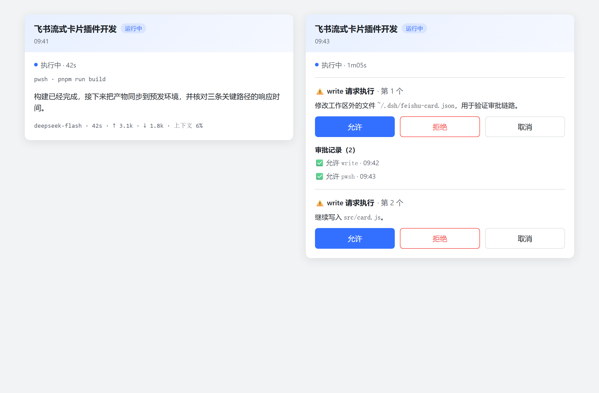
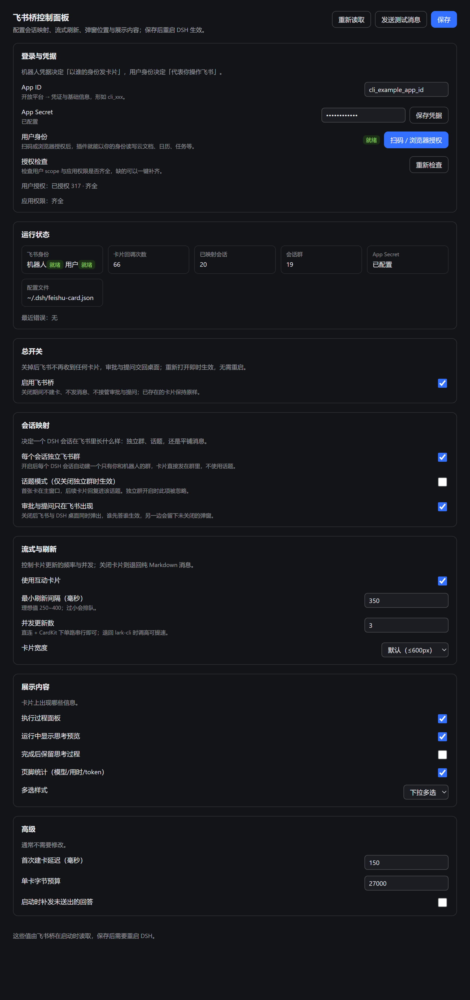
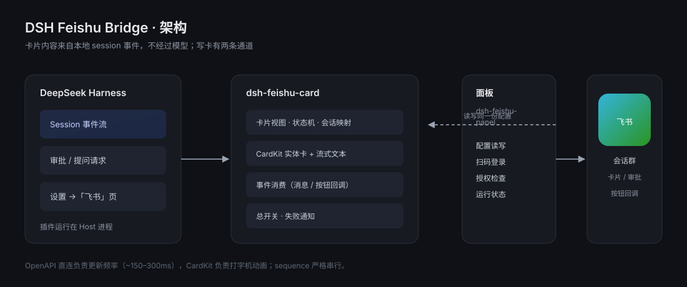

<div align="center">

# DSH Feishu Bridge

**把 DeepSeek Harness 的每一轮对话，变成飞书里一张持续更新的互动卡片。**

状态、正文、执行过程、统计都在同一张卡上实时刷新——而不是刷出一串消息。审批与提问也落在卡片里，形成闭环。

[](./LICENSE)
[](https://www.npmjs.com/package/@ethanhale_/dsh-feishu-card)
[](https://www.npmjs.com/package/@ethanhale_/dsh-feishu-panel)
[](https://github.com/deepseek-ai)
[](https://open.feishu.cn)
[](./CHANGELOG.md)
[](#设计取舍)

[特性](#特性) · [安装](#快速开始) · [配置](#配置) · [架构](#架构) · [限制](#已知限制)

</div>

<div align="center">
  
  <sub>左：流式输出的对话卡片　右：审批块直接嵌在同一张卡里（示例数据）</sub>
</div>

---

## 特性

| | |
| --- | --- |
| **流式卡片** | 直连飞书 OpenAPI 更新（~150–300ms/次），正文边生成边出现 |
| **打字机效果** | CardKit 卡片实体 + `streaming_mode`，文字按节奏逐字铺开 |
| **会话 1:1** | 每个 DSH 会话自动建一个独立飞书群；群里直接说话即继续，不用话题、不用「回复」 |
| **卡内审批** | 审批块插进当前回合卡片，**不产生第二张卡**；处理完整块消失，记录收进可折叠面板 |
| **卡内提问** | 多题一卡、一次提交；单选 / 多选下拉 / 自由输入 / 每题自定义答案 |
| **失败通知** | 额度、网络、超时等失败会 `@你` 并附原因，不再静默卡住 |
| **控制面板** | DSH 设置里一页图形化配置：总开关、会话形态、流式节奏、展示内容、扫码登录、授权检查 |

## 截图

<div align="center">
  
  <sub>设置 →「飞书」：总开关、登录与凭据、授权检查、运行状态、配置分组</sub>
</div>

## 试用 30 秒

```text
Plugins → Add plugin → packages/dsh-feishu-card
Plugins → Add plugin → packages/dsh-feishu-panel
重启 DSH → 设置 →「飞书」→ 扫码登录 → 打开「启用飞书桥」
```

然后在任意会话里说一句话，飞书里就会出现那张卡片。

## 快速开始

### 前置

- **DSH**（自带 Cordis 插件系统）
- **lark-cli**，已 `lark-cli auth login`
- 一个**飞书自建应用**（拿 App ID / App Secret）

### 1. 安装

```powershell
# 已发布到 npm 后（推荐）
dsh plugin add @ethanhale_/dsh-feishu-card
dsh plugin add @ethanhale_/dsh-feishu-panel

# 或者直接从源码目录安装
dsh plugin add <本仓库>/packages/dsh-feishu-card
dsh plugin add <本仓库>/packages/dsh-feishu-panel
```

装完**重启 DSH**。面板会出现在 设置 →「飞书」。

### 2. 凭据

在面板「登录与凭据」里填 App ID / Secret 保存，或手写 `~/.dsh/feishu-card.secret.json`：

```json
{ "appId": "cli_xxxxxxxxxxxx", "appSecret": "xxxxxxxxxxxxxxxx" }
```

没有密钥文件时退回 `lark-cli` 通道：可用，但每次调用约 1.1s（启动 + 鉴权开销）。

### 3. 应用权限与事件

**租户权限（tenant）**

```
im:message            im:message.group_msg      im:message:readonly
im:message:update     im:resource               im:chat
im:chat.members:read  cardkit:card:write
```

**事件订阅**

```
im.message.receive_v1      收消息
card.action.trigger        卡片按钮 / 表单回调
application.bot.menu_v6    （可选）机器人菜单点击
```

> `im:message.group_msg` 是关键：没有它，机器人只能收到私聊和群里 @ 它的消息，普通群消息收不到。

### 4. 配置

`~/.dsh/feishu-card.json`，面板读写同一份文件：

```json
{
  "enabled": true,
  "sessionChats": true,
  "thread": false,
  "feishuOnly": true,
  "card": {
    "widthMode": "default",
    "intervalMs": 350,
    "maxInflight": 3,
    "showTools": true,
    "showReasoning": false,
    "reasoningPreview": true,
    "footer": true,
    "multiSelectStyle": "dropdown"
  }
}
```

| 键 | 默认 | 说明 |
| --- | --- | --- |
| `enabled` | `true` | **总开关**。关闭后不建卡、不发消息、不接管审批与提问；重新打开即时生效 |
| `sessionChats` | `true` | 每个会话一个独立飞书群 |
| `thread` | `false` | 话题模式（仅 `sessionChats=false` 时生效） |
| `feishuOnly` | `true` | 审批/提问只在飞书出现，抑制桌面弹窗 |
| `card.intervalMs` | `350` | 最小刷新间隔，250–400 最佳 |
| `card.maxInflight` | `3` | 并发更新数；CardKit 路径下自动单路串行 |
| `card.showTools` | `true` | 执行过程面板 |
| `card.showReasoning` | `false` | 完成后保留思考过程 |
| `card.reasoningPreview` | `true` | 运行中显示思考预览 |
| `card.footer` | `true` | 页脚统计（模型 / 用时 / token） |
| `card.multiSelectStyle` | `dropdown` | 多选控件：`dropdown` / `checker` |

只有 `enabled` 是热生效的，其余键在挂载时读取——改完重启 DSH。

## 架构

<div align="center">
  
</div>

两条写卡通道分工明确：

| 通道 | 用途 | 时延 |
| --- | --- | --- |
| 直连 `im/v1/messages` + `cardkit/v1` | 建卡、更新、整卡替换 | ~150–300ms |
| CardKit `streaming_mode` | 正文流式文本（打字机） | ~250ms/元素 |

CardKit 对同一张卡的 `sequence` 要求严格递增，插件内部把「流式写入」和「审批写入」串到同一把锁上，避免 `300317`。

## 飞书里的用法

- **会话群**：直接说话就继续该会话，不需要「回复」某条消息；
- **控制台（机器人私聊）**：

```
/dsh sessions        列出会话与对应的飞书群（带直达链接）
/dsh workspaces      列出工作区
/dsh new             新建会话
/dsh doctor          检查卡片与事件通道
/dsh preview         发一张卡片预览
/dsh approval-test   生成一张带真实 pending 的审批卡，自检用
```

- **快捷指令**：可注册成 `/dsh-*` 斜杠指令；机器人菜单可绑定 `dsh_sessions` 等 `event_key`。

## 设计取舍

- **不额外调用模型**：卡片内容全部来自本地 session 事件，token 成本为零。
- **不用话题**：会话 1:1 映射成独立群，手机上不用点进话题才能看到更新。
- **审批不新开卡**：审批块插进当轮卡片，处理完即消失，只留折叠记录——一屏能看到上下文和决策。
- **失败必须说话**：额度耗尽之类的空回合会 `@你` 并说明原因，而不是留一张「运行中」的卡。

## 已知限制

- CardKit 的 `sequence` 冲突没有重试兜底，外部脚本不要并发写同一张卡。
- 应用权限只能由企业管理员在开放平台审批；面板能探测与跳转，不能自授。
- 「信任本会话」等价于把会话权限预设切到完全放行，属于提权操作，会二次确认。
- 飞书卡片不能引用本地图片路径，图片需先上传拿 `image_key`。

## 开发

```powershell
npm run check   # 7 个 JS 文件语法自检，无需 DSH 运行
```

改 `packages/dsh-feishu-card/lib/*.js` 后需**重启 DSH**（插件走 ESM 缓存）；面板可在 Plugins 里禁用/启用触发重载。

详见 [CONTRIBUTING.md](./CONTRIBUTING.md)。

## License

[MIT](./LICENSE)
